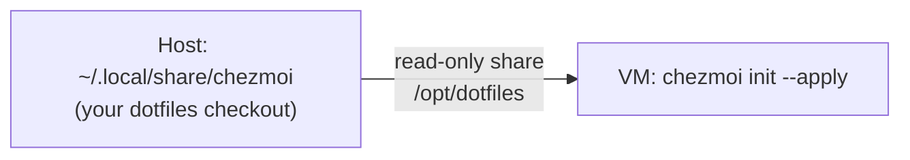
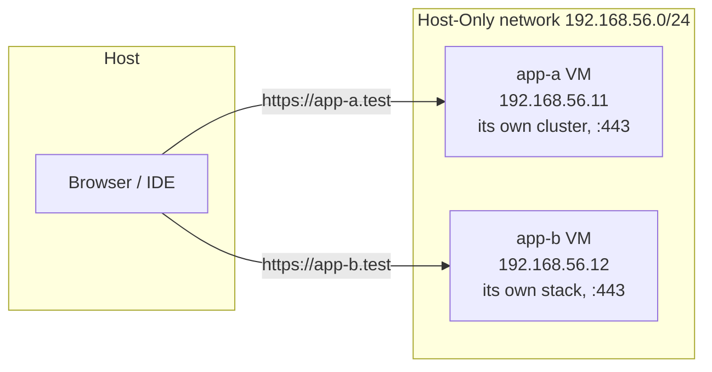

# Vagrant Sandbox

Automated, portable Vagrant setup for a disposable development VM. Works
across network environments (home, work, offline).

## Features

* **Network modes** — Host-Only (private) or Bridge (static / DHCP).
* **Idempotent provisioning** — skips already-installed tools.
* **SSH key injection** — host public key added to the VM for passwordless login.
* **Host terminfo sync** — installs the host `$TERM` in the VM (fixes Ghostty etc.).
* **Host DNS** — VM resolves through the host resolver (follows host VPN DNS).
* **Dotfiles via chezmoi (optional)** — applies the host's dotfiles checkout (read-only share, no token in the VM).
* **AI CLIs preinstalled** — Antigravity (`agy`), Claude Code (`claude`), Codex (`codex`).

## Prerequisites

**1. VirtualBox 7.2** (Ubuntu's own package; Vagrant 2.4.9 supports up to 7.2):

```bash
sudo apt update && sudo apt install virtualbox
VBoxManage --version            # 7.2.x
```

> **Secure Boot on?** The kernel module (`vboxdrv`) is built by DKMS and signed
> with the machine's module-signing key. The first time, the install asks for a
> one-time password to enroll that key: reboot and, in the blue MOK Manager
> screen, choose *Enroll MOK* and type it. If `VBoxManage --version` warns the
> driver isn't loaded, enroll it by hand:
> `sudo mokutil --import /var/lib/shim-signed/mok/MOK.der`, then reboot.
>
> Oracle's own build (newer patch releases) is an alternative:
> [Linux downloads](https://www.virtualbox.org/wiki/Linux_Downloads), package
> `virtualbox-7.2`. Use one or the other, not both.

**2. Vagrant** ([HashiCorp apt repo](https://developer.hashicorp.com/vagrant/install)):

```bash
wget -O- https://apt.releases.hashicorp.com/gpg | sudo gpg --dearmor --yes --output /usr/share/keyrings/hashicorp-archive-keyring.gpg
echo "deb [signed-by=/usr/share/keyrings/hashicorp-archive-keyring.gpg] https://apt.releases.hashicorp.com $(lsb_release -cs) main" | sudo tee /etc/apt/sources.list.d/hashicorp.list
sudo apt update && sudo apt install vagrant
```

**3. SSH key pair** at `~/.ssh/id_ed25519{,.pub}` (`ssh-keygen -t ed25519`). The
public half is injected into the VM.

> Copied a key from a drive/backup/cloud sync? Fix its modes first — they
> often land world-readable and OpenSSH then silently falls back to a
> password prompt:
> `chmod 700 ~/.ssh && chmod 600 ~/.ssh/id_ed25519 && chmod 644 ~/.ssh/id_ed25519.pub`

**4. Dotfiles (optional)** — your [chezmoi](https://www.chezmoi.io/) dotfiles,
applied on provisioning. Without them (or with `USE_DOTFILES = false` in
`Vagrantfile.local`), the VM is a plain Ubuntu with the bootstrap packages and
the AI CLIs: install what your project needs (Docker, Node...) yourself. To add
them later, set `USE_DOTFILES = true` and run `vagrant provision <name>`.



If [chezmoi](https://www.chezmoi.io/)'s source dir exists on the host
(`DOTFILES_SOURCE`, default `~/.local/share/chezmoi`, a git checkout), it is
shared read-only into the VM and linked as the VM's chezmoi source. Nothing is
cloned and no GitHub credential enters the VM. Get it once with
`chezmoi init <your-dotfiles-repo>` on the host. To update the VM's dotfiles:
`git pull` in the checkout on the host, then `vagrant provision <name>` (or
`chezmoi apply` in the VM). Without the checkout, the VM gets no dotfiles.

Provisioning turns on the VM user's systemd instance
(`loginctl enable-linger`), as a login would, so dotfile scripts that enable
user services (`systemctl --user`) work; user services then keep running after
you log out of the VM.

**Undo.** The VM only reads the checkout; `vagrant destroy <name>` leaves the
host's dotfiles as they were. To stop sharing them, set `DOTFILES_SOURCE` to a
path that does not exist.

## Network modes (`NETWORK_MODE`)

| Value | Mode | IP | Use |
| :--- | :--- | :--- | :--- |
| `"private"` | Host-Only (default) | `192.168.56.10` | Daily use; no IP conflicts, works offline. |
| `"public_static"` | Bridge, static | `192.168.15.10` | Other LAN devices need to reach the VM. |
| `"public_dhcp"` | Bridge, DHCP | from router | Public connection where IPs are dynamic. |

## Apt mirror (`APT_MIRROR`)

The guest's apt uses `http://br.archive.ubuntu.com/ubuntu` instead of the box
default `archive.ubuntu.com`, which can be unreachable while country mirrors
still answer (`security.ubuntu.com` is left as is). Set `APT_MIRROR` in
`Vagrantfile.local` to another mirror, or to `""` to keep the box default.

If the bootstrap packages fail to install, provisioning stops right there
instead of going on with a user whose login shell (zsh) does not exist. Fix
the mirror and run `vagrant provision <name>`.

## Getting started

```bash
cd ~/repos/vagrant-sandbox
vagrant up
vagrant ssh                    # or: ssh user@192.168.56.10
vagrant halt | reload | provision
```

> `ssh` asking for a password instead of using the key = bad key permissions
> (see Prerequisites 3). Confirm with `ssh -v user@192.168.56.10`.

`~/.ssh/config` entry for `ssh vm-ubuntu`:

```ssh-config
Host vm-ubuntu
    HostName 192.168.56.10
    User user
    StrictHostKeyChecking accept-new
```

## Changing the box (e.g. a new Ubuntu LTS)

`BOX_IMAGE` only applies when a VM is created. To move a VM to a new box:
`vagrant destroy <name>` and `vagrant up <name>` (keep work in `~/repos`, which
lives on the host). The single VM's default name carries the box
(`VM-UBUNTU-26-04-<PROJECT>`): after a box change, Vagrant no longer finds the
old one. Keep it with `BOX_IMAGE = "cloud-image/ubuntu-24.04"` in
`Vagrantfile.local` until you recreate it, or destroy it first. Named machines
(`MACHINES`) keep their names.

## One VM per project

Projects that each need the same ports (an ingress on `443`, a Kubernetes
cluster) can't share a VM: whichever starts last takes the port. Give each
project its own VM, with its own IP on the Host-Only network, and start only
the ones you are testing.



Define `MACHINES` in `Vagrantfile.local`. The keys are the names used in
commands; every option falls back to the constants of the `Vagrantfile`:

```ruby
MACHINES = {
  "app-a" => { ip: "192.168.56.11", memory: "6144" },
  "app-b" => { ip: "192.168.56.12", memory: "4096", hostname: "my-app-b" },
}
```

| Option | Default |
| :--- | :--- |
| `ip` | `VM_PRIVATE_IP` (or `VM_BRIDGED_IP` in `"public_static"`); must be unique |
| `hostname` | the machine name |
| `display_name` | Vagrant default |
| `cpus` / `memory` / `disk` | `CPUs` / `MEMORY` / `DISK_SIZE` |
| `autostart` | `false`: a bare `vagrant up` starts nothing |

```bash
vagrant status                 # every VM and its state
vagrant up app-a               # creates or starts only app-a
vagrant halt app-a             # stops it, keeps its disk
vagrant ssh app-b              # or: ssh user@192.168.56.12
vagrant destroy app-b          # deletes that VM and its disk
```

A recreated VM has a new SSH host key, and `ssh` refuses it ("REMOTE HOST
IDENTIFICATION HAS CHANGED"). Drop the old one after a `destroy`:
`ssh-keygen -R 192.168.56.12` (its `ip`).

The host's RAM is shared by the running VMs: start the ones whose memory adds
up to what the host can spare. Each VM gets its own `~/.ssh/config` entry
(`HostName` = its `ip`).

**Keeping an existing VM.** Vagrant identifies a VM by the folder
`.vagrant/machines/<name>`. To keep the VM you already have as one of the
named machines, give it its current IP and names in `MACHINES` and rename the
folder while nothing runs a `vagrant` command:

```bash
mv .vagrant/machines/VM-UBUNTU-26-04-DEV-PROJECT .vagrant/machines/app-a
vagrant status                 # app-a: running (or poweroff)
```

**Back to a single VM.** `vagrant destroy` the VMs you no longer want, remove
`MACHINES` from `Vagrantfile.local` and rename the folder of the VM you keep
back to its `VM_NAME`
(`mv .vagrant/machines/app-a .vagrant/machines/VM-UBUNTU-26-04-DEV-PROJECT`).

## Customization (`Vagrantfile`)

Variables at the top of the `Vagrantfile` (override per machine in a
gitignored `Vagrantfile.local`):

| Variable | Default | Notes |
| :--- | :--- | :--- |
| `BOX_IMAGE` | `cloud-image/ubuntu-26.04` | Base box (the current LTS). Canonical stopped publishing `ubuntu/*` boxes after jammy; this is the cloud-image repack. A VM keeps the box it was created with: a new default only applies to new VMs. |
| `PROJECT` | `dev-project` | Label mixed into `VM_NAME` (the single VM; see [One VM per project](#one-vm-per-project) for several). |
| `HOSTNAME` | `vm-<box distro>` | Guest hostname; override in `Vagrantfile.local` without changing `VM_NAME` or the existing VM identity. |
| `VM_DISPLAY_NAME` | Vagrant default | Name shown in VirtualBox; override in `Vagrantfile.local` without changing the existing VM identity. |
| `CPUs` / `MEMORY` | `2` / `8192` | Cores / RAM (MB). |
| `DISK_SIZE` | `50GB` | Grow on `vagrant reload`; shrink needs a rebuild. |
| `USERNAME` / `PASSWORD` | `user` / `pass` | VM user. |
| `SSH_KEY_FILENAME` | `id_ed25519` | Host `~/.ssh` public key to inject. |
| `VM_PRIVATE_IP` | `192.168.56.10` | IP for `"private"` mode. |
| `VM_BRIDGED_IP` | `192.168.15.10` | IP for `"public_static"` mode. |
| `NETWORK_INTERFACE_PREFIX` | `en` | Host NIC prefix for Bridge (`wlp` = Wi-Fi). |
| `USE_DOTFILES` | `true` | `false` skips the dotfiles: a plain Ubuntu VM. |
| `DOTFILES_SOURCE` | `~/.local/share/chezmoi` | Host dotfiles checkout, shared read-only; without it, no dotfiles. |

## Running `vagrant` from any directory

`vagrant` only finds this VM from a directory with a `Vagrantfile`. Add this
wrapper to `~/.zshrc` or `~/.bashrc` (works in both) to point it here by
default while still respecting other Vagrant projects:

```bash
vagrant() {
  if [[ -f Vagrantfile || -f ../Vagrantfile || -n "$VAGRANT_CWD" ]]; then
    command vagrant "$@"
  else
    VAGRANT_CWD="$HOME/repos/vagrant-sandbox" command vagrant "$@"
  fi
}
```

(A plain `export VAGRANT_CWD="$HOME/repos/vagrant-sandbox"` also works but
targets this sandbox from *everywhere*.) Re-`source` the rc file afterwards.

## Commit conventions

[Conventional Commits](https://www.conventionalcommits.org/pt-br/v1.0.0-beta.4/):

* Subject `<type>(<scope>)?: <desc>` — ≤ 50 recommended, **72 hard limit**.
  Types: `build chore ci docs feat fix perf refactor revert style test`.
  `!` before `:` marks a breaking change.
* Body optional: blank line after the subject, lines wrapped at **72**.
* No `Co-Authored-By:` trailer.

Enforced by a global `commit-msg` hook (via `core.hooksPath`) managed in this
maintainer's personal dotfiles, not tracked in this repo — no per-clone setup
needed here.

## Moving files to the VM

`shared/` is a drop folder between the host and every VM: put a file there on
the host and it shows up in the VM at `~/repos/vagrant-sandbox/shared` (through
the `~/repos` share), and the other way around.

The folder is versioned empty: everything inside it is gitignored, so nothing
dropped there reaches this public repo. Clear it when the transfer is done.

```bash
cp ~/Downloads/report.pdf ~/repos/vagrant-sandbox/shared/   # on the host
ls ~/repos/vagrant-sandbox/shared                            # in the VM
```

## Repos & Git

**Recommended — keep git on the host.** `~/repos` is shared into the VM at
`/home/USERNAME/repos`. Edit inside the VM; run all `clone`/`fetch`/`pull`/`push`
from the host with your own keys. The repo then survives `vagrant destroy`, and
a disposable VM never touches your remotes.

**Git inside the VM.** The VM holds no GitHub credential. Connect with agent
forwarding (`ssh -A`, or `ForwardAgent yes` in `~/.ssh/config`) and use SSH
remotes (`git@github.com:you/repo.git`): `clone`, `pull` and `push` then use
your host key, which never leaves the host. A clone made inside the VM dies
with it, outside `~/repos`.

The VM's `~/.local/share/chezmoi` is a read-only link to the host's checkout:
commit and push dotfile changes on the host.
